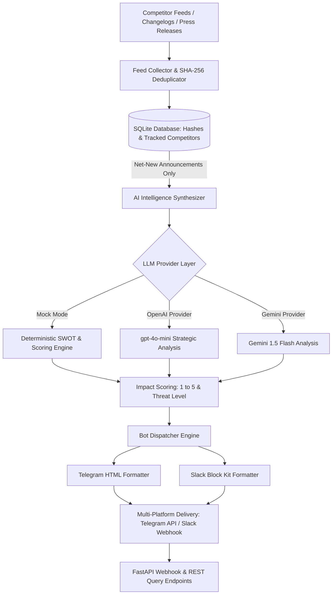

# MarketRadar Bot 📡🤖

> **Autonomous B2B Competitive Intelligence & Multi-Platform Executive Briefing Bot.**

[](https://github.com/your-username/market-radar-bot/actions)
[](LICENSE)
[](https://python.org)
[](https://fastapi.tiangolo.com)

---

## 🎯 GitHub Metadata
- **Description**: Automated B2B market intelligence scanner that crawls competitor announcements, analyzes strategic threats, and dispatches executive briefs to Slack and Telegram.
- **Topics**: `competitive-intelligence`, `market-intelligence`, `telegram-bot`, `slack-bot`, `fastapi`, `executive-briefing`, `ai-automation`, `python`
- **Suggested Commit**: `feat: complete MarketRadar Bot service with deduplication, SWOT threat scoring and multi-platform webhook delivery`

---

## 📌 Problem Statement
Founders, product executives, and strategy leaders spend countless hours every week manually checking competitor blogs, product changelogs, funding news, and industry feeds. High-priority developments (such as sudden pricing changes or key feature launches) are frequently missed or discovered too late to coordinate an effective response.

**MarketRadar Bot** automates strategic monitoring:
1. Ingests feeds and news releases across tracked competitors.
2. Deduplicates noise using SHA-256 content hashing.
3. Automatically synthesizes announcements, assigns a Strategic Impact Score (1 to 5), and generates tactical SWOT counter-strategies.
4. Dispatches formatted briefings directly to executive Slack channels (Block Kit) and Telegram groups (HTML formatting).
5. Provides an interactive webhook listener for on-demand bot commands (`/briefing`, `/status`).

---

## 🏛️ Architecture



---

## ✨ Features
- **Zero-Friction 5-Minute Setup**: Runs completely offline in mock mode with realistic competitor events (`LLM_PROVIDER=mock`).
- **Cryptographic Deduplication**: SHA-256 fingerprinting ensures executives never receive redundant alerts.
- **Strategic Threat Matrix**: Quantifies threats on a 1–5 scale with actionable recommendations.
- **Multi-Platform Formatter**: Native support for Telegram HTML message formatting and Slack Block Kit JSON payloads.
- **FastAPI Webhook Server**: Supports Telegram bot updates and Slack slash commands directly.
- **Dockerized & CI-Tested**: Includes Dockerfile, `docker-compose.yml`, and GitHub Actions workflow.

---

## 🚀 Quick Start (< 2 Minutes)

### 1. Installation
```bash
git clone https://github.com/your-username/market-radar-bot.git
cd market-radar-bot

python -m venv venv
source venv/bin/activate  # On Windows: venv\Scripts\activate

pip install -r requirements.txt
```

### 2. Configure Environment
```bash
cp .env.example .env
# Runs out-of-the-box in mock mode!
```

### 3. Start the Webhook & API Server
```bash
uvicorn app.main:app --host 0.0.0.0 --port 8001 --reload
```
Open **[http://localhost:8001/docs](http://localhost:8001/docs)** to inspect the OpenAPI docs.

---

## 📡 API & Webhook Usage Examples

### 1. Trigger On-Demand Intelligence Scan
```bash
curl -X POST "http://localhost:8001/api/v1/scan" -H "Content-Type: application/json" -d '{"force_rescan": true}'
```
**Response Sample:**
```json
{
  "briefing_id": "BRF-8F2B1C04",
  "events_count": 3,
  "analyses": [
    {
      "competitor_name": "AcmeCloud",
      "event_title": "AcmeCloud Announces 35% Price Cut Across Enterprise GPU & Serverless Tiers",
      "strategic_impact_score": 4,
      "threat_level": "HIGH",
      "swot_implications": "Strengthens competitor's mid-market cost advantage...",
      "tactical_recommendation": "Review our compute tier margins; launch value-add bundling..."
    }
  ],
  "dispatched_status": "DELIVERED"
}
```

### 2. Test Telegram Bot Webhook (`/briefing`)
```bash
curl -X POST "http://localhost:8001/webhook/telegram" \
  -H "Content-Type: application/json" \
  -d '{"message": {"chat": {"id": 12345}, "text": "/briefing"}}'
```

---

## ⚙️ Configuration Reference

| Variable | Default | Description |
|----------|---------|-------------|
| `LLM_PROVIDER` | `mock` | Active provider (`mock`, `openai`, `gemini`) |
| `LLM_MODEL` | `gpt-4o-mini` | LLM model name |
| `DELIVERY_MODE` | `mock` | Delivery target (`mock`, `telegram`, `slack`, `both`) |
| `TELEGRAM_BOT_TOKEN` | `""` | Telegram Bot token |
| `TELEGRAM_CHAT_ID` | `""` | Target Telegram group/channel ID |
| `SLACK_WEBHOOK_URL` | `""` | Slack Incoming Webhook URL |
| `DATABASE_PATH` | `data/market_radar.sqlite3` | SQLite database file location |

---

## 🧪 Running Tests
```bash
pytest tests/ -v
```

---

## 📂 Project Structure
```
market-radar-bot/
├── app/
│   ├── collectors/
│   │   ├── mock_feeds.py      # Sample competitor announcements
│   │   └── rss_parser.py      # Feed parser & SHA-256 deduplicator
│   ├── config.py              # Pydantic BaseSettings
│   ├── main.py                # FastAPI endpoints & webhook listeners
│   ├── models/
│   │   ├── database.py        # SQLite storage
│   │   └── schemas.py         # Data schemas
│   ├── providers/
│   │   ├── base.py            # Abstract provider
│   │   ├── mock_provider.py   # Deterministic SWOT engine
│   │   ├── openai_provider.py # OpenAI integration
│   │   └── gemini_provider.py # Gemini integration
│   ├── services/
│   │   ├── bot_dispatcher.py  # Telegram HTML & Slack Block Kit formatter
│   │   └── synthesizer.py     # End-to-end intelligence cycle
│   └── utils/
│       └── logger.py
├── tests/
│   ├── test_rss_parser.py
│   ├── test_synthesizer.py
│   ├── test_bot_dispatcher.py
│   └── test_api_integration.py
├── Dockerfile
├── docker-compose.yml
├── requirements.txt
└── README.md
```

---

## 🗺️ Roadmap
- [x] Feed collector with SHA-256 content deduplication
- [x] Strategic threat & SWOT scoring engine
- [x] Telegram HTML & Slack Block Kit dispatchers
- [x] Webhook slash command handlers
- [ ] Automated daily cron worker with Celery/APScheduler
- [ ] SEC EDGAR financial 10-K filing parser integration

---

## 📄 License
Released under the [MIT License](LICENSE).
